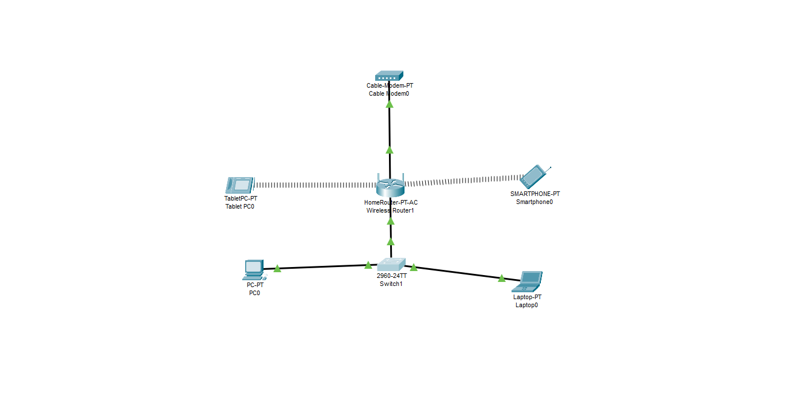

# Lab 01: SOHO-DHCP Network

## Objective
Design and verify a Small Office/Home Office (SOHO) network providing automated IPv4 addressing and local connectivity for both wired and wireless end devices.

## Topology & Devices
* **WAN / Internet Edge:** `Cable Modem0` (Cable-Modem-PT)
* **Gateway & Wireless:** `Wireless Router1` (HomeRouter-PT-AC)
* **LAN Switching:** `Switch2` (Cisco 2960-24TT)
* **Wired Clients:** `PC0` (PC-PT), `Laptop0` (Laptop-PT)
* **Wireless Clients:** `Tablet PC0` (TabletPC-PT), `Smartphone0` (Smartphone-PT)

## Network Configuration Summary
* **WAN Connection Type:** Automatic Configuration – DHCP
* **LAN Network / Subnet:** `192.168.0.0/24` (`255.255.255.0`)
* **Default Gateway (Router LAN IP):** `192.168.0.1`
* **DHCP Server Status:** Enabled
* **DHCP Address Pool:** `192.168.0.100 – 192.168.0.149` (50 max users)
* **Client Lease Time:** 1440 minutes (24 hours / default)

## Key Skills Demonstrated
* **SOHO Infrastructure Design:** Integrated a cable modem, wireless home router, and Layer 2 switch to support mixed wired and wireless endpoints.
* **DHCP Configuration:** Configured automatic IPv4 address, subnet mask, and default gateway assignment across local hosts.
* **Wireless LAN Setup:** Connected mobile endpoints (`Tablet PC0` and `Smartphone0`) to the wireless router access point.
* **Connectivity Verification:** Verified end-to-end Layer 3 reachability between wired (`PC0`, `Laptop0`) and wireless hosts using `ipconfig` and `ping`.

## Configuration Files
* [Switch Running Configuration](./switch1-config.txt)
