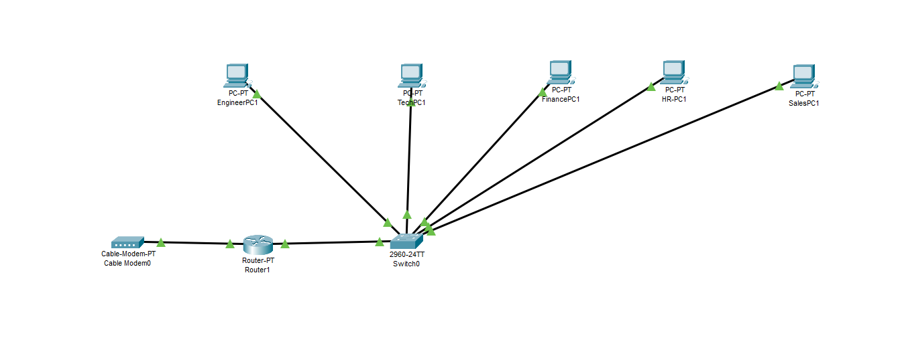

# Lab 02: Department VLANs & Inter-VLAN Routing

## Objective
Design and verify a segmented enterprise network that isolates five department broadcast domains using 802.1Q VLANs, while providing centralized DHCP addressing and inter-VLAN routing via a Router-on-a-Stick architecture.

## Topology & Devices
* **WAN / Internet Edge:** `Cable Modem0` (Cable-Modem-PT)
* **Inter-VLAN Router & DHCP Server:** `Router1` (Router-PT)
* **Layer 2 Access Switch:** `Switch0` (Cisco 2960-24TT)
* **Department Endpoints:** `EngineerPC1`, `ITPC1`, `FinancePC1`, `HR-PC1`, `SalesPC1`

## VLAN & IP Addressing Table

| VLAN ID | Department | Endpoint Host | Subnet / Mask | Default Gateway |
| :--- | :--- | :--- | :--- | :--- |
| **VLAN 2** | Engineering | `EngineerPC1` | `192.168.2.0/24` (`255.255.255.0`) | `192.168.2.1` |
| **VLAN 3** | IT | `ITPC1` | `192.168.3.0/24` (`255.255.255.0`) | `192.168.3.1` |
| **VLAN 4** | Finance | `FinancePC1` | `192.168.4.0/24` (`255.255.255.0`) | `192.168.4.1` |
| **VLAN 5** | Human Resources (HR) | `HR-PC1` | `192.168.5.0/24` (`255.255.255.0`) | `192.168.5.1` |
| **VLAN 6** | Sales | `SalesPC1` | `192.168.6.0/24` (`255.255.255.0`) | `192.168.6.1` |

## Key Skills Demonstrated
* **VLAN Segmentation:** Configured five dedicated VLANs (VLANs 2–6) on `Switch0` to separate departmental traffic and avoid using default VLAN 1 for user data.
* **802.1Q Trunking & Subinterfaces:** Configured an 802.1Q trunk link between `Switch0` and `Router1` with dot1Q subinterfaces for inter-VLAN routing.
* **Multi-Pool Router DHCP:** Configured five distinct IOS DHCP pools (`VLAN2`–`VLAN6`) on `Router1` to dynamically assign IPv4 addresses and default gateways per department.
* **Connectivity Verification:** Verified dynamic IP lease acquisition across all department PCs and tested cross-VLAN reachability with `ping`.

## Configuration Files
* [Router1 Running Configuration](./router-config.txt)
* [Switch0 Running Configuration](./switch-config.txt)
