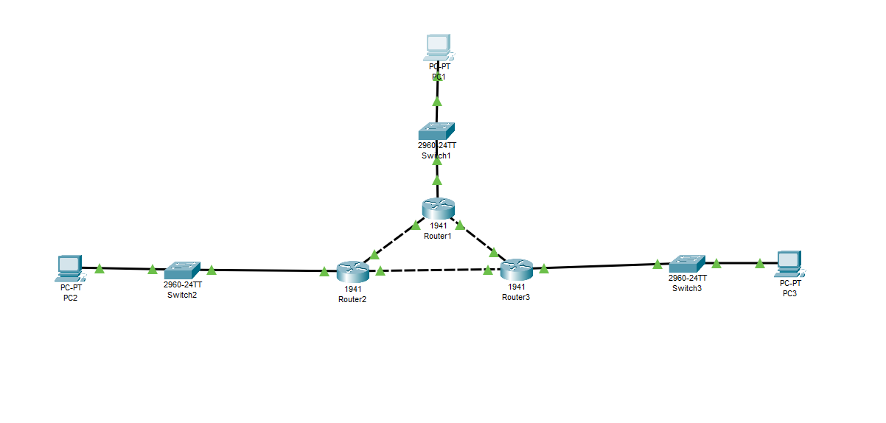
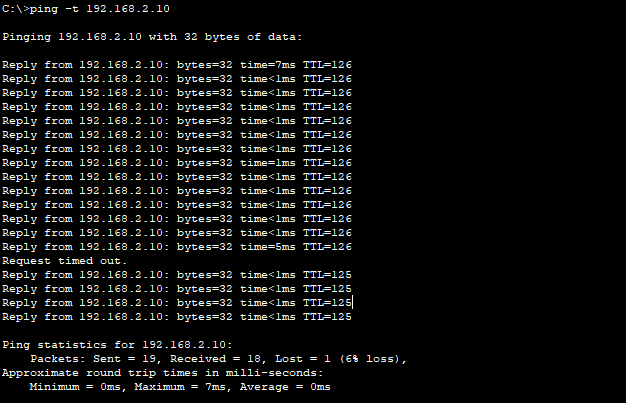
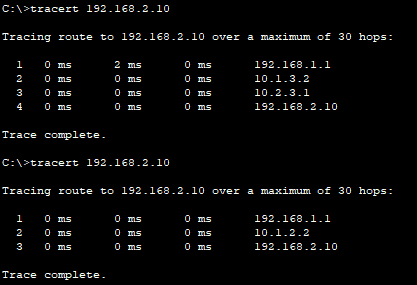

# Lab 03: 3-Router Triangle Topology & OSPF Failover

## Objective
Design and verify a redundant 3-router full-mesh triangle topology connecting three separate local area networks (LANs), testing both manual static routing and dynamic single-area OSPFv2 routing (`Process ID 1, Area 0`) with automatic link-failure convergence and failback.

## Topology & Hardware
* **Core / WAN Routers:** `Router1`, `Router2`, `Router3` (Cisco 1941 with HWIC-4ESW Ethernet Switch Modules)
* **LAN Access Switches:** `Switch1`, `Switch2`, `Switch3` (Cisco 2960-24TT)
* **End Devices:** `PC1`, `PC2`, `PC3` (PC-PT)

## IP Addressing & Interface Summary

| Device / Link | Interface / SVI | IP Address / Subnet | Mask / Wildcard |
| :--- | :--- | :--- | :--- |
| **LAN 1 (`Router1` → `Switch1` → `PC1`)** | `Fa0/1/0` (`Vlan1` SVI) | `192.168.1.1` (`192.168.1.0/24`) | `255.255.255.0` (`0.0.0.255`) |
| **LAN 2 (`Router2` → `Switch2` → `PC2`)** | `Fa0/1/0` (`Vlan1` SVI) | `192.168.2.1` (`192.168.2.0/24`) | `255.255.255.0` (`0.0.0.255`) |
| **LAN 3 (`Router3` → `Switch3` → `PC3`)** | `Fa0/1/0` (`Vlan1` SVI) | `192.168.3.1` (`192.168.3.0/24`) | `255.255.255.0` (`0.0.0.255`) |
| **WAN Link (`Router1` ↔ `Router2`)** | `Gi0/0` ↔ `Gi0/0` | `10.1.2.1` ↔ `10.1.2.2` (`10.1.2.0/30`) | `255.255.255.252` (`0.0.0.3`) |
| **WAN Link (`Router1` ↔ `Router3`)** | `Gi0/1` ↔ `Gi0/0` | `10.1.3.1` ↔ `10.1.3.2` (`10.1.3.0/30`) | `255.255.255.252` (`0.0.0.3`) |
| **WAN Link (`Router2` ↔ `Router3`)** | `Gi0/1` ↔ `Gi0/1` | `10.2.3.1` ↔ `10.2.3.2` (`10.2.3.0/30`) | `255.255.255.252` (`0.0.0.3`) |

## OSPF Failover & Recovery Verification

### 1. Continuous Ping Convergence (`ping -t 192.168.2.10`)
While running a continuous ping from `PC1` to `PC2`, the direct WAN cable between `Router1` and `Router2` was unplugged:
* **Primary Path (`TTL=126`):** Traffic initially traversed 2 router hops (`Router1` → `Router2`).
* **Convergence (`Request timed out.`):** OSPF detected the link failure and converged after dropping only 1 packet.
* **Backup Path (`TTL=125`):** Traffic automatically rerouted across 3 router hops (`Router1` → `Router3` → `Router2`).

### 2. Traceroute Failover vs. Failback (`tracert 192.168.2.10`)
Running `tracert` from `PC1` confirmed both the backup path during the outage and automatic restoration once the primary cable was reconnected:
* **Unplugged (4 hops via `Router3`):** `192.168.1.1` → `10.1.3.2` (`Router3`) → `10.2.3.1` (`Router2`) → `192.168.2.10`
* **Plugged Back In (3 hops direct):** `192.168.1.1` → `10.1.2.2` (`Router2`) → `192.168.2.10`

## Key Skills Demonstrated
* **Redundant WAN Design:** Built a full-mesh 3-router triangle topology with `/30` point-to-point WAN subnets and HWIC-4ESW switched LAN interfaces (`Vlan1` SVIs).
* **OSPFv2 Configuration:** Configured single-area OSPF (`router ospf 1`, `area 0`) using exact subnet wildcard masks (`0.0.0.3` and `0.0.0.255`) for neighbor adjacency and SPF path calculation.
* **Failover & Failback Verification:** Validated automatic link-failure rerouting and primary path recovery using `ping -t`, TTL hop analysis, and `tracert`.

## Configuration Files
* [Router1 Running Configuration](./router1-config.txt)
* [Router2 Running Configuration](./router2-config.txt)
* [Router3 Running Configuration](./router3-config.txt)
